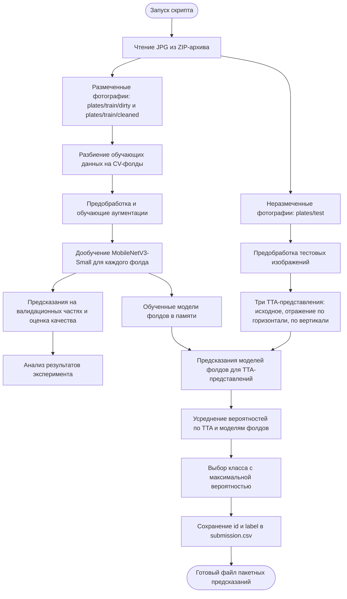
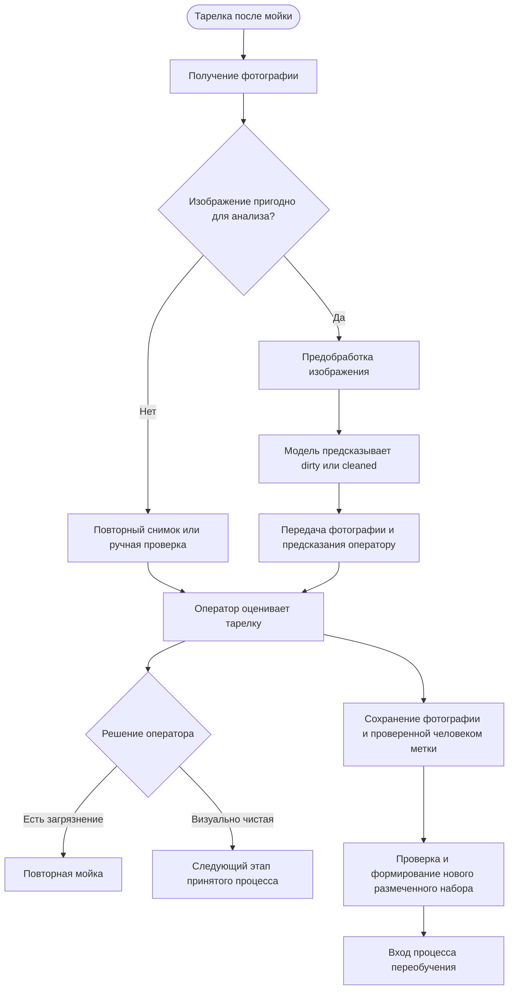

# Место модели в процессе проекта

## Назначение и границы

Проект `cleaned-vs-dirty-plates` — учебный прототип бинарной классификации фотографий тарелок. Модель определяет визуальный класс изображения: `dirty` — грязная тарелка, `cleaned` — чистая тарелка. Описание модели и её ограничений приведено в [Model Card](model_card.md).

В репозитории реализован **офлайн-процесс обучения, кросс-валидации и пакетного предсказания**. Результат работы — файл `submission.csv` с идентификаторами изображений и предсказанными метками. Работающий API, интерфейс оператора и производственная система контроля мойки в проекте не реализованы. В текущем скрипте обученные модели используются в памяти; сохранение их весов на диск не является отдельным реализованным этапом.

Ниже приведены две схемы: фактический технический процесс и предполагаемый прикладной сценарий. Это схемы потоков процесса в Mermaid; они не претендуют на полное соответствие формальной нотации BPMN 2.0.

## 1. Текущий технический процесс

Схема отражает логику [исходного скрипта platesv2_baseline.py](https://github.com/deqo-deqo/cleaned-vs-dirty-plates/blob/main/platesv2_baseline.py).

| Этап | Вход | Что происходит | Результат для следующего шага |
| --- | --- | --- | --- |
| Получение данных | ZIP-архив с JPG | Скрипт читает изображения; метки обучающих примеров определяются по каталогам `dirty` и `cleaned` | Размеченная обучающая выборка и неразмеченная тестовая выборка |
| Кросс-валидация и обучение | Обучающие изображения и метки | Данные разбиваются на фолды. На обучающих частях выполняется дообучение предобученной MobileNetV3-Small с выходом на два класса | Модели фолдов в памяти и предсказания для валидации |
| Оценка качества | Валидационные предсказания и истинные метки | Рассчитываются показатели эксперимента; ошибки используются для анализа ограничений модели | Результаты оценки для исследователя; автоматического допуска к эксплуатации здесь нет |
| Подготовка входа при предсказании | Тестовое JPG-изображение | Преобразование в RGB, дополнение до квадрата (`SquarePad`), изменение размера до `int(160 × 1.12)`, центральная обрезка до `160 × 160`, нормализация ImageNet | Входной тензор в формате, ожидаемом моделью |
| Предсказание с TTA | Подготовленное изображение и модели фолдов | Для исходного изображения и двух отражений рассчитываются вероятности; результаты усредняются по TTA и моделям | Две усреднённые оценки классов |
| Формирование результата | Усреднённые оценки классов | Выбирается класс `argmax`: `dirty = 0`, `cleaned = 1`; итог экспортируется в CSV | `submission.csv` с колонками `id,label` для последующей обработки |

Файл CSV — конечный артефакт текущего процесса. Его можно использовать для просмотра предсказаний, сопоставления с доступной разметкой и анализа ошибок. Скрипт не отправляет тарелки на повторную мойку и не принимает производственные решения.

## 2. Предполагаемое применение: помощник визуальной проверки после мойки

**Статус: проектируемый сценарий, не реализованное внедрение.** Модель могла бы помогать оператору замечать видимые загрязнения на фотографиях после мойки. Она классифицирует внешний вид изображения и не подтверждает санитарную безопасность посуды.

| Этап | Вход | Что происходит | Результат для следующего шага |
| --- | --- | --- | --- |
| Получение и проверка снимка | Фотография тарелки после мойки | Проверяется, что изображение читается и позволяет оценивать тарелку; непригодные снимки переснимаются либо направляются на ручную проверку | Пригодное изображение или задача оператору |
| Классификация | Пригодное изображение | Выполняются согласованная с обучением предобработка и предсказание класса | Предсказание `dirty` или `cleaned`, связанное с конкретным изображением |
| Использование результата | Фотография и предсказание | Оператор получает подсказку и самостоятельно оценивает тарелку; подозрительные случаи могут получать приоритет просмотра | Решение человека о дальнейшей обработке |
| Дальнейшее действие | Решение оператора | Тарелка направляется на повторную мойку или следующий этап установленного процесса | Исполненное решение и запись о результате проверки |
| Обратная связь | Фотография и подтверждённая человеком метка | Разметка проверяется, фиксируется и может войти в новый набор данных | Проверенные примеры для [процесса переобучения](Model_retrain_BPMN.md) |

Предсказания модели сами по себе не считаются истинными метками и не должны автоматически попадать в обучающий набор. Для обратной связи требуется разметка или подтверждение человеком.

## Почему для этой задачи уместен ML

Внешний вид тарелок и загрязнений меняется: влияют цвет и рисунок посуды, форма остатков пищи, освещение, блики и ракурс. Набор фиксированных правил по цвету или яркости может плохо переноситься между такими условиями. Модель компьютерного зрения позволяет обучать признаки по размеченным примерам и проверять их полезность на отложенных данных.

Это обоснование выбора подхода, а не доказательство готовности текущей модели к применению. Перед эксплуатацией необходимы репрезентативные данные, проверка качества на целевых условиях съёмки и согласованные критерии допуска. Особое значение имеет пропуск грязной тарелки: ошибочное предсказание `cleaned` может скрыть проблему от оператора. Поэтому в предлагаемом сценарии решение остаётся за человеком.

## Связь с MLOps

Текущий проект позволяет изучать воспроизводимость обучения и оценку качества. Разделение фактического пакетного предсказания и проектируемого применения помогает определить будущие требования к сопровождению: единая предобработка, связь предсказания с версией модели, сбор проверенной обратной связи и контролируемая замена версии. Условия публикации и действия при неуспешных проверках описаны отдельно в [Model_retrain_BPMN.md](Model_retrain_BPMN.md).
