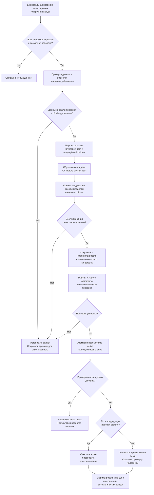

# Процесс автоматического переобучения модели классификации тарелок

Проект: [cleaned-vs-dirty-plates](https://github.com/deqo-deqo/cleaned-vs-dirty-plates).

Модель определяет по фотографии, относится ли тарелка к классу `dirty` (метка `0`) или `cleaned` (метка `1`). Предполагаемое применение — учебный помощник для предварительной визуальной проверки тарелок после мойки. Окончательное решение принимает человек: фотография и результат классификации не подтверждают санитарную безопасность посуды.

## Статус процесса

Ниже описан **предлагаемый процесс**, а не уже реализованная автоматизация. Сейчас проект использует MobileNetV3-Small, обучение с кросс-валидацией и получение предсказаний в CSV. Настройки по умолчанию: 3 разбиения, 6 эпох и `seed=42`. Веса обученных моделей остаются в памяти; сохранение через `torch.save`, реестр моделей, сервис предсказаний, автоматический деплой и мониторинг пока не реализованы.

Цель схемы — определить, как впоследствии воспроизводимо обучать кандидата, проверять его и допускать к учебной эксплуатации. Указанные ниже пороги — предлагаемые требования, **не достигнутые результаты текущей модели и не доказательство готовности к промышленной эксплуатации**.

## Схема

При отказе до переключения `active` действующая версия продолжает работать, если она существует. Если восстановление предыдущей версии тоже не прошло проверку, предсказания демо отключаются.

## Этапы и передаваемые результаты

| Этап | Вход | Что происходит | Выход на следующий этап |
|---|---|---|---|
| 1. Триггер | Новые фотографии и журнал предыдущих запусков | Планировщик раз в неделю проверяет, накопилось ли хотя бы 50 новых фотографий с разметкой человека и представлены ли оба класса. Ручной запуск разрешён для проверки процесса, но не отменяет требования к данным и качеству. | Идентификатор запуска и список новых размеченных изображений; при отсутствии данных — ожидание. |
| 2. Получение и проверка данных | Новые фотографии, разметка и предыдущая версия датасета | Проверяются читаемость и допустимый формат изображений, корректность меток `0/1`, связь файла с меткой, наличие обоих классов. Человек разрешает спорные случаи. Точные и близкие дубликаты удаляются или объединяются в одну группу. | Проверенный набор либо отчёт об ошибках, блокирующий запуск. |
| 3. Версия данных и разделение | Проверенный набор с идентификаторами тарелки и сессии съёмки | Фиксируются версия, контрольные суммы, разметка и состав разделений. Изображения одной тарелки или сессии относятся к одной группе и не пересекают train и holdout. Проверяются также дубликаты между разделениями. | Неизменяемый снимок датасета, train и защищённый holdout не менее чем по 50 независимым изображениям каждого класса. При нехватке данных — остановка. |
| 4. Обучение кандидата | Train, конфигурация, версия кода и окружения | Обучается ансамбль MobileNetV3-Small. Кросс-валидация и выбор настроек выполняются только внутри train, также с учётом групп. Аугментации применяются к обучающей части; holdout не используется для настройки модели. | Веса всех моделей разбиений, журнал обучения, конфигурация и метрики CV. |
| 5. Проверка качества | Кандидат, текущая версия при её наличии, базовый прогноз и защищённый holdout | На одинаковых изображениях рассчитываются accuracy, recall класса `dirty`, macro-F1 и матрица ошибок. Проверяются абсолютные пороги и отсутствие ухудшения относительно базовых моделей. | Отчёт с метриками и однозначное решение «допустить» или «отклонить». |
| 6. Сохранение и регистрация | Кандидат, прошедший оценку, и отчёт | Создаётся неизменяемый артефакт с уникальной версией и статусом `candidate`. Сохранение версии ещё не делает её активной. | Зарегистрированный кандидат с полным набором файлов и метаданных. |
| 7. Staging | Сохранённый артефакт кандидата | Артефакт загружается в отдельном окружении; выполняется сквозная проверка от изображения до результата. Контролируются формат вывода, карта классов, конечность вероятностей и загрузка всех весов. | Отчёт smoke-проверки и разрешение на переключение версии либо отказ. |
| 8. Деплой демо | Проверенный кандидат и текущий указатель `active` | Запоминается предыдущая рабочая версия. Указатель `active` атомарно переключается на кандидата; выполняется проверка получения предсказания через интерфейс демо. | Активная версия и запись о публикации либо сигнал для отката. |
| 9. Откат и завершение | Ошибка после деплоя и предыдущая версия | Указатель возвращается на предыдущую рабочую версию, затем проверяется восстановление. Если рабочей версии нет или откат не помог, предсказания отключаются, проверка остаётся у человека. | Восстановленное демо либо отключённое демо, журнал инцидента и задача ответственному. |

Порог «50 новых фотографий» определяет запуск проверки накопления данных, а не гарантирует возможность обучения и допуска. В частности, первоначальное формирование holdout минимум из 100 изображений может потребовать отдельного сбора данных. Идентификаторы групп должны фиксироваться при сборе: при невозможности исключить пересечение тарелок или сессий выпуск блокируется.

## Правила допуска кандидата

Кандидат допускается к staging, только если одновременно выполнены все условия:

- holdout содержит не менее 50 изображений каждого класса и не пересекается с обучением по группам и дубликатам;
- `accuracy >= 0.80`;
- `recall_dirty >= 0.90`, где положительным для этой метрики считается именно класс `dirty` с меткой `0`;
- `macro-F1 >= 0.80`;
- каждая из трёх метрик не ниже соответствующей метрики текущей версии на том же holdout, если текущая версия существует;
- каждая из трёх метрик не ниже метрики простого baseline, который всегда предсказывает наиболее частый класс **обучающего** набора; правило разрешения равенства частот фиксируется в конфигурации;
- обучение и оценка завершились без ошибок, все модели разбиений доступны, а протокол запуска полон.

Если текущей сохранённой версии ещё нет, сравнение с ней пропускается; абсолютные пороги и сравнение с baseline остаются обязательными. Эти учебные пороги подлежат обоснованию на данных предполагаемого применения. Даже 50 примеров на класс не гарантируют статистически надёжный допуск: в отчёте сохраняются числа ошибок и неопределённость оценки, а промышленная эксплуатация требует отдельной валидации.

## Состав версии модели

Для воспроизведения сохраняются:

- веса **всех** моделей разбиений ансамбля, их контрольные суммы и описание архитектуры;
- карта классов `dirty: 0`, `cleaned: 1`, правила обработки изображений, нормализация, размер входа, настройки TTA и объединения предсказаний;
- конфигурация обучения, seed, версия датасета и списки групп в разделениях;
- SHA коммита, `poetry.lock` и необходимые версии среды выполнения;
- метрики кандидата и сравниваемых моделей, матрица ошибок, журналы обучения и проверок;
- идентификатор запуска, дата регистрации, статус версии и история переключений `active`.

Артефакт регистрируется как неактивный кандидат. Только успешная staging-проверка разрешает его публикацию. При обучении неожиданный отказ загрузки ImageNet-весов должен останавливать запуск: текущий код допускает резервный переход к случайной инициализации, который меняет конфигурацию эксперимента. При оценке и деплое отсутствующие или несовместимые веса кандидата также должны приводить к явной ошибке, без подмены другой инициализацией.

## Защита от ошибочного переобучения

Разметку новых данных подтверждает человек. Предсказания модели не принимаются автоматически за правильные ответы. Неуспешный запуск сохраняет причину отказа и завершается без бесконечных повторов; повторный запуск выполняется после исправления причины или появления новых данных.

Holdout не используется для подбора гиперпараметров, порогов и аугментаций. Решения по обучению принимаются по train/CV, а итоговый кандидат проверяется по заранее зафиксированному протоколу. Повторные выпуски и обращения к holdout журналируются; после накопления решений по его результатам требуется новый независимый контрольный набор, размеченный до просмотра предсказаний кандидата. Иначе постепенная подстройка под тест даст завышенную оценку качества.

Результат процесса — воспроизводимая, проверенная версия учебного демо либо документированный отказ в обновлении. Само появление новых данных или успешное завершение обучения не является основанием для деплоя.
